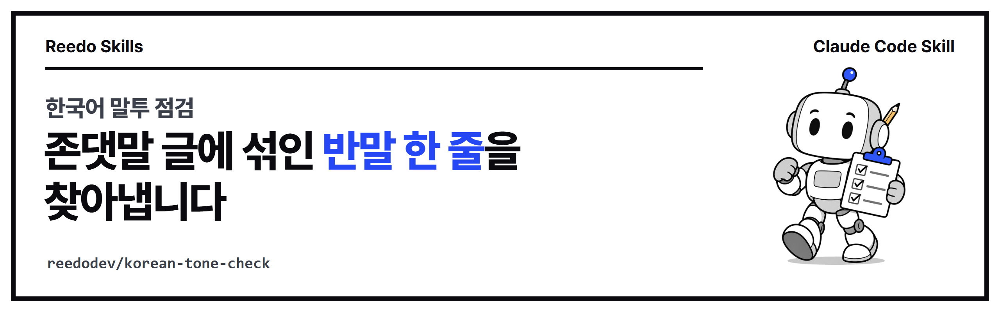

<p align="center"></p>

<p align="center">
<a href="https://github.com/reedodev/korean-tone-check/actions/workflows/test.yml"></a>


</p>

# 한국어 말투 점검 (korean-tone-check)

글에 섞인 합니다체·해요체·반말 종결을 찾아 목표 말투와 다르면 실패로 멈추고, AI 티가 나는 상투어·번역투·짧은 문장 나열은 참고로 표시합니다. 블로그, SNS, 카드뉴스, 영상 대본을 발행하기 직전에 씁니다.

## 처음 쓰시는 분을 위한 안내

### 이 스킬이 해결하는 문제

합니다체로 쓴 글에 "처음엔 어려웠어요." 같은 해요체나 "진짜 좋아." 같은 반말이 한 줄 섞여 있으면 읽는 분이 어색하게 느낍니다. 눈으로 읽어서는 놓치기 쉬워서, 발행하기 직전에 이 스킬로 검사합니다.

- 상황 1: 블로그 글을 합니다체로 쓰기로 했는데, 중간에 반말 문장이 남아 있는지 확인하고 싶을 때
- 상황 2: AI가 쓴 초안에 "결론적으로", "혁신적인" 같은 상투어와 번역투가 많은지 보고 싶을 때

### 용어 풀이

- **터미널**: 명령을 글자로 입력하는 창입니다. Windows는 PowerShell 또는 Windows Terminal, Mac은 터미널 앱입니다.
- **Claude Code**: 터미널에서 쓰는 AI 코딩 에이전트(사용자 대신 파일을 읽고 명령을 실행해 주는 AI)입니다.
- **스킬**: 에이전트가 읽고 그대로 따르는 사용 설명서(SKILL.md)와 실행 파일을 묶은 폴더입니다.
- **합니다체 / 해요체 / 반말**: "~합니다", "~해요", "~한다·~해"처럼 문장을 끝내는 말투의 종류입니다.

### 준비 확인

이 스킬은 Node.js(자바스크립트를 실행하는 프로그램) 18 이상만 있으면 됩니다. 터미널에서 확인합니다.

```bash
node -v
```

`v18.0.0` 이상의 숫자가 나오면 준비가 끝났습니다. 명령을 찾을 수 없다고 나오면 [nodejs.org](https://nodejs.org)에서 LTS 버전을 설치하거나, 터미널에서 설치합니다.

- Windows: `winget install OpenJS.NodeJS.LTS` 실행 후 터미널을 닫았다 다시 엽니다.
- Mac: `brew install node` (Homebrew가 있을 때)

### 따라 하기 3단계

**1단계. 설치합니다.** Claude Code 안에서 아래 두 줄을 입력합니다. Claude Code 없이 스크립트만 쓰려면 아래 "바로 해 보기"로 바로 가셔도 됩니다.

```
/plugin marketplace add reedodev/korean-tone-check
/plugin install korean-tone-check@korean-tone-check
```

**2단계. 에이전트에게 이렇게 말합니다.** 아래 문장을 복사해서 쓰시면 됩니다. `draft.md`는 검사할 글 파일 이름으로 바꿉니다.

1. `korean-tone-check 스킬로 draft.md가 합니다체로 일관되는지 검사해 줘.`
2. `반말이나 해요체가 섞인 문장만 찾아서 고쳐 줘. 내용은 바꾸지 마.`
3. `고친 뒤에 한 번 더 검사해서 통과했는지 알려 줘.`

**3단계. 결과를 확인합니다.** 마지막 줄이 `FAIL`이면 목표 말투와 다른 문장이 있다는 뜻이고, 고친 뒤 FAIL이 없으면 통과입니다.

### 실제 실행 결과 예시

이 저장소의 예시 글로 직접 실행한 결과입니다.

```bash
node skills/korean-tone-check/scripts/check-tone.mjs skills/korean-tone-check/examples/sample.md --target hamnida
```

```
target=hamnida  sentences=14  hamnida:11 haeyo:1 plain:1 casual:1 noun:0 other:0
L3 [상투어] 도입 상투어: 바로 본론으로 들어가세요 | 오늘은 AI 자동화에 대해 알아보겠습니다.
L3 [상투어] 과장 수식어 | 이 도구는 혁신적인 기능을 가지고 있습니다.
L3 [상투어] 번역투(have): “~이 있다”로 | 이 도구는 혁신적인 기능을 가지고 있습니다.
L4 [말투] (haeyo) 처음엔 어려웠어요.
L4 [말투] (plain) 그래도 했다.
L4 [말투] (casual) 진짜 좋아.
L4 [리듬] 짧은 문장 7개 연속: 연결어미로 이유와 결과를 이어 보세요 | 처음엔 어려웠어요. 그래도 했다. 진짜 좋아. 설정은 간단합니다. 시간도 줄어듭니다. 실수도 줄어듭니다. 비용도 아낍니다.
L6 [상투어] 정리 상투어 | 결론적으로 자동화는 중요한 역할을 합니다.
L6 [상투어] 빈 의미의 강조 | 결론적으로 자동화는 중요한 역할을 합니다.
L6 [상투어] 얼버무림 종결 | 이것은 시간을 아끼는 방법이라고 할 수 있습니다.
FAIL: 목표 말투와 다른 문장 3개
```

읽는 법은 다음과 같습니다.

- 맨 위 줄은 문장 14개 중 합니다체가 11개이고, 해요체·평서체·반말이 하나씩이라는 요약입니다.
- `L4`처럼 앞에 붙은 숫자는 글의 몇 번째 줄인지 알려 줍니다. `[말투]`는 목표 말투와 다른 문장이라 꼭 고쳐야 하고, 마지막 `FAIL` 줄과 종료 코드 1이 이 때문에 나옵니다.
- `[상투어]`, `[리듬]`은 참고 의견입니다. 고칠지는 글쓴이가 정하며 이것만으로는 FAIL이 되지 않습니다.

### 막힐 때

| 증상 | 원인 | 해결 |
|---|---|---|
| `file not found: nofile.md` (종료 코드 2) | 파일 이름이나 위치가 다릅니다 | 검사할 글이 있는 폴더에서 실행하거나 파일의 전체 경로를 적습니다 |
| `unknown --target "foo": use hamnida, haeyo or plain` (종료 코드 2) | `--target`에 없는 값을 적었습니다 | `hamnida`(합니다체), `haeyo`(해요체), `plain`(평서체) 중 하나를 씁니다 |
| `usage: node check-tone.mjs <file\|-> ...` (종료 코드 2) | 검사할 파일을 적지 않았습니다 | 명령 끝에 글 파일 이름을 넣습니다 |
| 마지막 줄이 `FAIL: 목표 말투와 다른 문장 3개` (종료 코드 1) | 오류가 아니라 검사 결과입니다. 말투가 다른 문장이 있습니다 | `[말투]`로 표시된 줄을 고친 뒤 다시 실행합니다 |

<!-- prereq-adapt -->
## 무엇이 필요한가요?

꼭 필요한 것은 Node 18 이상, 검사할 글 파일(.md 또는 .txt), 목표 말투 한 가지입니다. 권장·선택 준비물까지 정리한 표는 [SKILL.md의 준비물](skills/korean-tone-check/SKILL.md#준비물-쓰기-전에-있어야-하는-것)에 있습니다.

## 바꿔 쓰기

에이전트에게 다음처럼 말하면 옵션을 바꿔서 실행합니다.

- "이 글은 해요체로 맞춰 줘" → `--target haeyo` (합니다체는 `hamnida`, 칼럼·기사체는 `plain`)
- "'게임 체인저', '혁신적인' 같은 말은 내 글에서 빼 줘" → `--cliches my-list.txt` 한 줄에 하나씩 `표현|이유`로 적습니다
- "짧은 문장 지적이 너무 많아" → `--min-run 5` (몇 문장이 이어질 때 지적할지), `--short 10` (짧다고 볼 글자 수)

말과 옵션의 대응표는 [SKILL.md의 바꿔 쓰기](skills/korean-tone-check/SKILL.md#바꿔-쓰기-이렇게-말하세요)에 있습니다.

## 설치

**Claude Code 플러그인으로 설치**

```
/plugin marketplace add reedodev/korean-tone-check
/plugin install korean-tone-check@korean-tone-check
```

**폴더만 복사**

```bash
git clone https://github.com/reedodev/korean-tone-check.git
cp -r korean-tone-check/skills/korean-tone-check ~/.claude/skills/
```

필요한 것: Node 18+

## 바로 해 보기

```bash
node skills/korean-tone-check/scripts/check-tone.mjs skills/korean-tone-check/examples/sample.md --target hamnida
```

예시 글에는 말투가 다른 문장이 일부러 들어 있어서 마지막 줄이 `FAIL`로 끝나고 종료 코드가 1인 것이 정상입니다. 내 글을 검사할 때는 파일 이름만 바꿉니다.


자세한 절차, 옵션, 한계는 [SKILL.md](skills/korean-tone-check/SKILL.md)에 있습니다. 에이전트가 이 파일을 읽고 그대로 따릅니다.

## 시험

`node tests/run.mjs`가 SKILL.md 형식을 검사하고 예시 파일로 스크립트를 실제로 실행합니다. 푸시할 때마다 GitHub Actions가 같은 시험을 돌립니다(위 test 배지).

<!-- credits -->
## 출처와 영감

- **참고한 프로젝트**: 한국어 AI 문체 분류는 [epoko77-ai/im-not-ai](https://github.com/epoko77-ai/im-not-ai)(MIT), 영어 AI 문체 패턴은 [blader/humanizer](https://github.com/blader/humanizer)를 작성자가 글쓰기 작업에 써 오면서 참고했습니다. 이 스킬은 두 프로젝트의 규칙 파일이나 코드를 옮기지 않았고, 상투어 목록과 종결어미 판정 규칙은 직접 만든 짧은 목록입니다. 깊은 윤문이 필요하면 원래 프로젝트를 쓰는 것을 권합니다.

## 만든 사람

**리도**, AI 좌충우돌 실습 중인 20년차 엔지니어입니다. 매일 AI에게 일을 맡기다가 막힌 부분을 고쳐 가며 이 스킬을 만들었습니다.
[YouTube @Reedodev](https://www.youtube.com/@Reedodev) · [Threads @reedo.dev](https://www.threads.com/@reedo.dev) · [GitHub @reedodev](https://github.com/reedodev)

같이 만든 다른 스킬: [설명 영상 만들기](https://github.com/reedodev/explainer-studio) · [옵시디언 3D 지식그래프](https://github.com/reedodev/obsidian-brain-3d) · [노트 먼저 찾아보기](https://github.com/reedodev/vault-recall) · [작업 기록 강의자료](https://github.com/reedodev/work-to-lecture-deck) · [네이버 황금키워드](https://github.com/reedodev/naver-golden-keywords) · [한글 양식 채우기](https://github.com/reedodev/hwpx-form-fill) · [TTS 끝소리 고치기](https://github.com/reedodev/tts-tail-fix) · [카드뉴스 렌더](https://github.com/reedodev/html-card-render) · [영상 비율 검사](https://github.com/reedodev/social-video-gate) · [유튜브 게시 점검](https://github.com/reedodev/youtube-publish-checklist)

---

## English

Flags mixed Korean speech levels (formal/polite/plain), stock AI phrases, translationese and choppy sentence runs. Exits 1 on speech-level mismatches so an agent cannot publish a mixed draft.

### New here? A beginner's guide

**What it solves.** When a post is written in the formal polite style (합니다체), one casual or plain sentence slipping in reads as a mistake, and it is easy to miss by eye. This skill checks a draft right before you publish.

- Case 1: you chose the formal style for a blog post and want to be sure no casual sentence is left.
- Case 2: an AI-written draft may be full of stock phrases ("in conclusion", "innovative") and translationese, and you want to see where.

**Glossary.**
- **Terminal**: a window where you type commands. PowerShell or Windows Terminal on Windows, the Terminal app on Mac.
- **Claude Code**: an AI coding agent that runs in the terminal and reads files and runs commands for you.
- **Skill**: a folder with instructions (SKILL.md) and scripts that the agent reads and follows.
- **합니다체 / 해요체 / plain**: Korean sentence endings: formal polite ("~합니다"), informal polite ("~해요"), and plain or casual ("~한다", "~해").

**Check your setup.** You only need Node.js 18 or newer.

```bash
node -v
```

If it prints `v18.0.0` or higher, you are ready. If the command is not found, install the LTS version from [nodejs.org](https://nodejs.org), or run `winget install OpenJS.NodeJS.LTS` (Windows, then reopen the terminal) or `brew install node` (Mac, with Homebrew).

**Three steps.**

1. Install it inside Claude Code (or skip this and run the script directly, see "바로 해 보기" above):

   ```
   /plugin marketplace add reedodev/korean-tone-check
   /plugin install korean-tone-check@korean-tone-check
   ```

2. Tell the agent, copying these sentences and replacing `draft.md` with your file:
   - `Use the korean-tone-check skill to check that draft.md is consistently in the formal polite style (hamnida).`
   - `Find only the sentences that are casual or informal polite and fix them. Do not change the meaning.`
   - `Check again after fixing and tell me whether it passes.`
3. Read the result. A last line starting with `FAIL` means some sentences do not match the target style. When no `FAIL` remains, it passes.

**Real sample output.** This is the actual result of running the command on the example file in this repository:

```bash
node skills/korean-tone-check/scripts/check-tone.mjs skills/korean-tone-check/examples/sample.md --target hamnida
```

```
target=hamnida  sentences=14  hamnida:11 haeyo:1 plain:1 casual:1 noun:0 other:0
L3 [상투어] 도입 상투어: 바로 본론으로 들어가세요 | 오늘은 AI 자동화에 대해 알아보겠습니다.
L3 [상투어] 과장 수식어 | 이 도구는 혁신적인 기능을 가지고 있습니다.
L3 [상투어] 번역투(have): “~이 있다”로 | 이 도구는 혁신적인 기능을 가지고 있습니다.
L4 [말투] (haeyo) 처음엔 어려웠어요.
L4 [말투] (plain) 그래도 했다.
L4 [말투] (casual) 진짜 좋아.
L4 [리듬] 짧은 문장 7개 연속: 연결어미로 이유와 결과를 이어 보세요 | 처음엔 어려웠어요. 그래도 했다. 진짜 좋아. 설정은 간단합니다. 시간도 줄어듭니다. 실수도 줄어듭니다. 비용도 아낍니다.
L6 [상투어] 정리 상투어 | 결론적으로 자동화는 중요한 역할을 합니다.
L6 [상투어] 빈 의미의 강조 | 결론적으로 자동화는 중요한 역할을 합니다.
L6 [상투어] 얼버무림 종결 | 이것은 시간을 아끼는 방법이라고 할 수 있습니다.
FAIL: 목표 말투와 다른 문장 3개
```

How to read it:
- The first line is a summary: of 14 sentences, 11 are formal polite and one each is informal polite, plain and casual.
- `L4` means line 4 of the file. `[말투]` (speech level) lines are real mismatches that you must fix; they cause the final `FAIL` line and exit code 1.
- `[상투어]` (stock phrase) and `[리듬]` (rhythm) lines are advice only. You decide whether to change them, and they never cause a failure.

**Troubleshooting.**

| Symptom | Cause | Fix |
|---|---|---|
| `file not found: nofile.md` (exit 2) | Wrong file name or folder | Run it from the folder that holds your draft, or give the full path |
| `unknown --target "foo": use hamnida, haeyo or plain` (exit 2) | A value that does not exist was given to `--target` | Use `hamnida`, `haeyo` or `plain` |
| `usage: node check-tone.mjs <file\|-> ...` (exit 2) | No input file was given | Add your draft's file name at the end of the command |
| Last line `FAIL: 목표 말투와 다른 문장 3개` (exit 1) | Not an error: the check found sentences in another speech level | Fix the lines marked `[말투]` and run again |

**Credits.**
- Informed by [epoko77-ai/im-not-ai](https://github.com/epoko77-ai/im-not-ai) (Korean AI-tell taxonomy) and [blader/humanizer](https://github.com/blader/humanizer). No rule files or code were copied; the phrase list and ending rules are original and much smaller.

Install: `/plugin marketplace add reedodev/korean-tone-check` then `/plugin install korean-tone-check@korean-tone-check`, or copy `skills/korean-tone-check` into `~/.claude/skills/`. See [SKILL.md](skills/korean-tone-check/SKILL.md) for the full procedure. MIT License; third-party models, fonts and libraries keep their own licenses.
